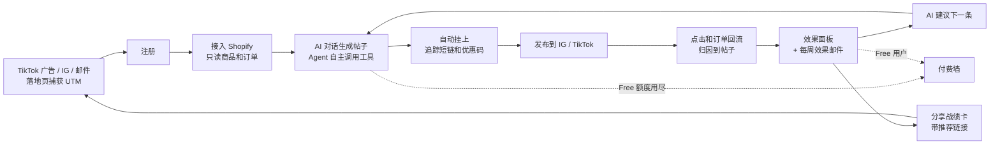

# Lumi v2 产品文档：效果闭环

> 一句话：让商家看到**每条帖子带来了多少订单**，并据此生成下一条。
> 可点击原型：[`/prototype/index.html`](../prototype/index.html)（浏览器直接打开；顶部可切换「Pro 商家」和「Free 商家」两个场景，右下角「埋点日志」显示每步上报的事件）
> 可运行版本：[`/app`](../app/README.md)（真实调用大模型，额度、埋点、短链归因均在后端实现，启动方式见其 README）

---

## 1. 目标用户与要解决的问题

**目标用户（v2 只服务这一类）：** 在 Shopify 上开店、主要用 Instagram 或 TikTok 发帖推广的海外中小电商卖家。原型中的示例商家是 Mia's Skincare。

本地小店和靠私信成交的商家暂不覆盖，因为他们没有可归因的线上订单（见第 4 节「不做」）。

**问题：** 商家用 Lumi 写了帖子，但不知道帖子有没有带来订单，于是觉得不值得续费。

| 证据 | 数字 |
|---|---|
| 付费用户主动反馈“不知道有没有带来订单” | 141 次提及，68% 来自付费用户，即 96 人，占全部 440 个付费用户的 22% |
| 全渠道付费用户 30 日留存 | 26%；TikTok 来源只有 8% |
| 每月新增付费约 180 个，付费总数却停在 440 | 月流失约 40% |

**v2 不解决什么：** 让文案写得更多、更花哨。“更多模板”的 312 次提及里 94% 来自免费用户，做了不会改善付费留存。

---

## 2. 本版本要验证的假设与成功标准

| # | 假设 | 验证方式 | 成功标准 |
|---|---|---|---|
| H1 | 商家能接入店铺，并真的看到归因订单 | M1 内测 30～50 名 Pro 商家，优先邀请反馈过“不知道效果”的 96 人 | **内测商家中看到 ≥1 笔归因订单的比例 ≥ 30%** |
| H2 | 看得见的订单能支撑 $29 定价 | M2 全量上线并切换新定价 | **新定价下 v2 新增付费 ≥ 100** |
| H3 | 看到订单的商家留得更久 | 比较看到订单与没看到订单两组商家的留存 | **M2 付费用户的 30 日留存 ≥ 50%**（现为 26%） |
| H4 | 战绩卡能带来推荐 | 统计分享卡分享次数和推荐注册 | 推荐带来的付费占新增付费 ≥ 15%（观察指标，不作为止损依据） |

**止损信号（第 4 周检查，原型「v2 指标」页有展示）：**

| 信号 | 阈值 | 触发后怎么办 |
|---|---|---|
| 接入店铺的内测商家比例 | < 30% | 简化接入流程，或重新评估方向 |
| 能归因到订单的商家比例 | < 20% | 退一步只展示点击和优惠码核销，并把目标用户收窄到 Shopify 卖家 |
| M2 新增付费 | < 50 | 说明价值或定价有问题，回调价格 |
| 提价后一个月内 Pro 流失 | > 25% | 回滚价格或延长保价期 |

---

## 3. 核心用户流程

**步骤说明（与原型页面对应）：**

1. **接入店铺**（「店铺连接」页）：输入店铺地址 → 通过 OAuth 只读授权 → 导入商品和近 30 天订单 → 创建追踪域名 `lumi.link/<店铺>`。
2. **AI 生成**（「内容创作」页）：商家用自然语言描述需求，Agent 依次调用以下工具：
   - `get_products`：找到要推的商品
   - `analyze_reviews`：从评价里提炼卖点
   - `get_post_performance`：查过去哪种风格转化最好
   - `generate_post`：生成帖子
   - `create_tracked_link`：挂上追踪短链和优惠码（仅 Pro）
3. **发布**：Pro 用户点「发布到 Instagram」，帖子进入效果列表，状态为“刚发布，等待数据”。Free 用户只能复制文案。
4. **看效果**（「效果分析」页）：顶部写“10 月，Lumi 帖子帮你带来了 23 单 · $1,140”；下面是每条帖子的点击、订单、营业额和匹配方式，以及每周订单趋势。
5. **下一条**：根据数据给出建议（UGC 风格转化 1.4%，科普类 0.8%），点「按这个生成」回到第 2 步。
6. **分享**：一键生成战绩卡分享到 IG Story，卡上带推荐链接；好友通过链接注册并付费后，双方各得 1 个月 Pro。

---

## 4. 功能清单与优先级

| 优先级 | 功能 | 说明 | 原型中 |
|---|---|---|---|
| **P0** | Shopify 只读接入 | OAuth，读取商品和订单，并订阅订单 webhook | ✓ |
| **P0** | AI 对话生成帖子 | Agent 通过 function calling 自主选择工具，界面上显示调用过程 | ✓ |
| **P0** | 追踪短链 + 专属优惠码 | 每条 Pro 帖子自动生成 | ✓ |
| **P0** | 订单归因 | 把订单匹配到帖子，规则见第 7 节 | 用 mock 数据展示 |
| **P0** | 效果面板 | 总订单和营业额、各帖子明细、每周趋势 | ✓ |
| **P0** | 额度与付费墙 | 额度在服务端校验；两种触发场景：额度用尽、使用 Pro 功能 | ✓ |
| **P0** | 埋点与 UTM 捕获 | 见第 6 节 | ✓（埋点日志） |
| P1 | AI 建议下一条 | 根据帖子表现给出建议 | ✓ |
| P1 | 战绩分享卡 + 推荐奖励 | 推荐双方各得 1 个月 Pro | ✓ |
| P1 | 每周效果邮件 | 每周一发送上周战绩 | — |
| P1 | 内部指标页 | M1～M3 判断数字和止损信号 | ✓ |
| P2 | 多语言生成 | 包含在 Pro 套餐中 | — |
| P2 | TikTok Shop 接入 | 等 Shopify 跑通后再做 | — |

**明确不做（本版本）：**

| 不做 | 原因 |
|---|---|
| 更多模板 | 94% 的需求来自免费用户，只会提高免费层成本，不解决付费留存 |
| 多人协作 | 只有 40 次提及；先用 Business 的 3 个席位满足，不单独开发协作功能 |
| 多触点归因模型 | 需要 6 周以上开发，样本量太小，模型不会稳定；v2 只用“短链 + 优惠码”的确定性规则 |
| 自动定时发布 | 需要申请 IG 和 TikTok 的发布权限，周期长，与验证“看得见订单”无关 |
| 本地小店（无线上订单） | 拿不到可归因的订单，面板会显示 0 单，反而证明产品“没用” |
| TikTok 预算翻倍 | 留存 8%，先按后端口径算清真实回本再决定 |

---

## 5. 付费边界与定价

| | **Free** | **Pro** | **Business** |
|---|---|---|---|
| 价格 | $0 | **$29 / 月** | $79 / 月 |
| 每月生成次数 | 10 | 500 | 2,000 |
| 追踪短链 + 优惠码 | ✗（卡片上显示锁定提示） | ✓ | ✓ |
| 效果面板 | ✗（模糊预览 + 升级入口） | ✓ | ✓ |
| AI 建议下一条、多语言 | ✗ | ✓ | ✓ |
| 席位 | 1 | 1 | 3 |
| 其他 | 帖子带 “Made with Lumi” | — | 高级归因 |

**设计逻辑：** 按“看得见的效果”收费，而不是按生成次数。免费层降低成本，并成为传播入口；“无限生成”改为有上限，杜绝重度用户成本倒挂（目前用量最高的 10% 用户每人每月成本 $31，高于 $19 的售价）。

**财务测算（稳态，详见 Part A 的 A3）：**

| | 调整前 | 调整后 |
|---|---|---|
| 月收入 | $8,360 | $11,511 |
| 月模型成本 | $16,838 | $6,815 |
| 毛利 | **−$8,478** | **+$4,696（约 41%）** |

**老用户：** 现有 $19 的 Pro 用户保价 3 个月。M2 的种子用户（创始商家）终身享受 $19。

**付费墙文案（与原型一致）：**
- **额度用尽：** “本月 10 次免费生成已用完。额度将在 11 月 1 日重置。升级 Pro，不只是多生成——还能看到每条帖子带来了多少订单。”
- **使用 Pro 功能：** “看到每条帖子带来了多少订单”，并附上“上个月 Pro 商家平均通过 Lumi 帖子带来 23 单”。

---

## 6. 埋点表

**原则：**
- 涉及钱、额度、归因的事件**一律服务端上报**，作为唯一可信来源。
- 只有服务端感知不到的 UI 曝光才在前端上报。
- 所有事件都带公共属性：`user_id`、`plan`、`platform`、`app_version`（App 端）、服务端时间戳。

| 事件名 | 触发时机 | 关键属性 | 上报端 | 对应指标 |
|---|---|---|---|---|
| `signup_completed` | 账号创建成功 | utm_source / utm_medium / utm_campaign / utm_content, ttclid, landing_page, platform | 服务端 | 各渠道注册量与转化 |
| `store_connected` | Shopify OAuth 回调成功 | store_platform, store_id, orders_last_30d | 服务端 | 店铺接入率（止损信号） |
| `post_generated` | 模型成功返回并通过校验 | post_id, template_id, language, model, tokens, cost_usd, quota_remaining | 服务端 | 生成量、人均模型成本、额度消耗 |
| `tracked_post_published` | Pro 用户点击发布 | post_id, short_link_id, discount_code, channel | 服务端 | 带追踪的帖子占比 |
| `link_clicked` | 短链跳转服务收到请求 | short_link_id, post_id, referrer, device, country, is_bot | 服务端（跳转服务） | 帖子点击量 |
| `order_attributed` | 订单 webhook 匹配到帖子 | order_id, post_id, revenue, currency, match_method(utm/code), click_to_order_hours | 服务端 | **北极星：看到 ≥1 笔归因订单的商家占比**、归因营业额 |
| `dashboard_viewed` | 效果面板曝光 | period, attributed_orders_count, entry(nav/email/push) | 前端 | 价值感知率（与留存做相关分析） |
| `paywall_viewed` | 付费墙曝光 | trigger(quota / feature_tracking / results_locked) | 前端 | 各触发场景下付费墙的曝光与转化 |
| `subscription_started` | 支付服务端回调成功（Stripe webhook / App Store Server Notifications） | plan, price, platform, trigger, 首触与末触 UTM | 服务端 | 新增付费、MRR、各渠道 CAC |
| `share_card_shared` | 点击分享到 IG Story 或复制推荐链接 | channel(instagram_story / copy_link), referral_code | 前端 | 分享率、推荐带来的注册和付费 |

> 原型的「埋点日志」能演示除 `link_clicked` 和 `order_attributed` 以外的 8 个事件，这两个在原型中用 mock 数据体现在效果面板上。可运行版本（`/app`）中 10 个事件都会真实写入数据库，可在其「埋点记录」页查看。

---

## 7. 给工程师的关键规则与边界情况

### 7.1 额度

| 规则 | 说明 |
|---|---|
| 计数单位 | 每次**成功生成**计 1 次；「重新生成」也计 1 次（原型按钮上已写明） |
| 不扣额度的情况 | 模型超时、报错、返回空内容或未通过内容安全审核；AI 回答查询类问题（查效果、问建议），不调用 `generate_post` 时不扣 |
| 重置时间 | 每个自然月 1 日 00:00（UTC） |
| 校验位置 | **服务端**在调用模型前校验，并原子扣减；前端只负责展示，不能作为拦截依据 |
| 并发 | 同一用户的并发请求用分布式锁或数据库行锁，防止超额 |
| 升级 | 立即生效，本月已用次数保留，上限改为新套餐的上限（原型中 Free 用完 10 次后升级 Pro，显示 10 / 500） |
| 降级或到期 | 当月已有的追踪短链继续跳转、继续记录点击和订单，但效果面板锁定；下月按 Free 额度执行 |

### 7.2 追踪短链与优惠码

- 短链格式 `lumi.link/<店铺>/<4 位随机码>`，跳转到商品页，并附加 `utm_source=lumi&utm_campaign=<post_id>`。
- 优惠码格式 `<店铺前缀>15-<序号>`，例如 `MIA15-101`；通过 Shopify Discount API 创建，默认 85 折，商家可以修改或关闭。
- 「重新生成」时，复用这条帖子已有的短链和优惠码，不新建，避免链接越来越多。
- 机器人点击过滤：识别常见爬虫的 UA（包括 Instagram 和 TikTok 的链接预览抓取），同一 IP 在 10 秒内的重复点击只计一次；被过滤的点击保留记录，标记 `is_bot=true`。

### 7.3 订单归因

| 情况 | 处理 |
|---|---|
| 订单带 `utm_campaign=<post_id>` | 归因到该帖子，`match_method=utm` |
| 订单使用了帖子的专属优惠码 | 归因到该帖子，`match_method=code` |
| UTM 和优惠码同时命中，且指向不同帖子 | **以优惠码为准**（用户主动输入，意图更明确），且只计一次 |
| 归因窗口 | 点击后 7 天内下单；超出窗口不计 |
| 退款或取消 | 收到退款 webhook 后撤销归因，面板实时扣减 |
| 部分退款 | 按退款金额扣减营业额，订单数不变 |
| 重复 webhook | 按 `order_id` 幂等处理 |
| 币种 | 按下单当天汇率折算成美元展示，同时保留原币金额 |

### 7.4 AI 生成的异常处理

| 情况 | 处理 |
|---|---|
| 模型超时（> 20 秒）或返回 5xx 错误 | 自动重试 1 次；仍失败则提示“生成失败，未扣额度，请重试”，同时记录错误日志 |
| 返回内容为空或格式不对 | 按失败处理，不扣额度 |
| 工具调用参数非法（如商品不存在） | 把错误返回给 Agent，让它追问商家（“没找到这个商品，你指的是……吗？”），不要直接报错给用户 |
| Agent 连续调用工具超过 6 轮 | 强制停止，返回已经拿到的结果 |
| 内容安全（夸大功效、违禁词等） | 生成后过一遍审核规则；命中则改写一次，仍不通过就提示商家，并且不扣额度 |
| 店铺未接入 | 生成功能可以使用，但不挂追踪；在卡片上提示接入店铺 |
| 效果数据为 0（刚发布） | 显示“刚发布，等待数据”，不显示为 0 单，避免让商家误以为“没用” |

### 7.5 数据口径

- 投放决策**以后端数字为准**；TikTok 后台的数字只作为平台内的优化信号。
- 落地页把 UTM 和 ttclid 同时写入 cookie 和服务端 session。注册时写入用户表，此后归因跟着 `user_id` 走，不跟着设备走。
- App 端付费以服务端通知（App Store Server Notifications / Google RTDN）为准，并通过 `appAccountToken = user_id` 关联到广告来源。

---

## 8. AI 使用说明

| 用在哪 | 工具 | 人工把关 |
|---|---|---|
| 可点击原型 | Claude Code | 我定页面清单、数据和文案；在浏览器里逐个场景点击验证 |
| 本文档初稿 | Claude Code | 结构按题目要求的 8 项；数字与 Part A 和原型逐项核对 |
| 可运行版本 `/app` | Claude Code；模型用 DeepSeek（OpenAI 兼容接口） | 我定工具清单、额度与归因规则；端到端测试覆盖关键规则，并在浏览器里走通完整链路 |

**没有采纳 AI 的地方：多触点归因模型**

- **背景：** 设计订单归因规则时，AI 建议做多触点归因：一个用户可能先后点过好几条帖子才下单，按时间衰减把一笔订单拆分给多条帖子（例如最近一条占 60%、前一条占 30%、更早的占 10%），理由是“更公平、更准确”。
- **为什么不采纳：**
  1. 样本太小。一个小商家一个月只有二十几笔归因订单，再拆到多条帖子上，权重模型不会稳定。
  2. 商家看不懂。面板上出现“这条帖子带来 0.37 单”，商家会困惑，反而降低对数据的信任，而 v2 的核心就是让商家相信效果数据。
  3. 工期不允许。这一块至少多 2 周开发，而第一个月要验证的是“商家能不能看到订单”，不是“归因有多精确”。
- **最终做法：** 用确定性规则：订单带了某条帖子的 UTM 或优惠码，就整单算给那条帖子；两者冲突时以优惠码为准，一笔订单只计一次（见 7.3）。多触点归因等样本量上来之后再评估。
